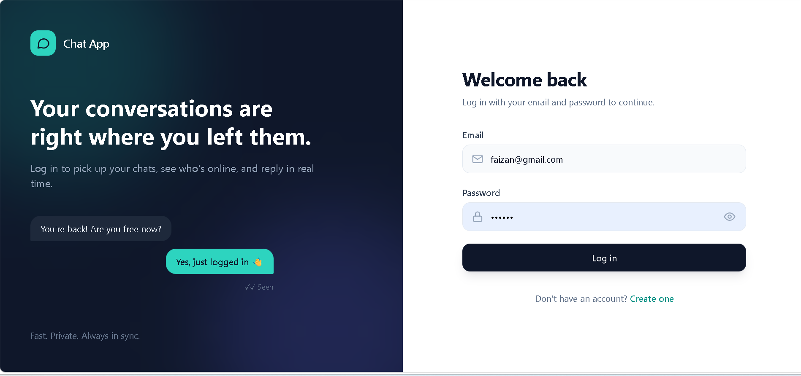
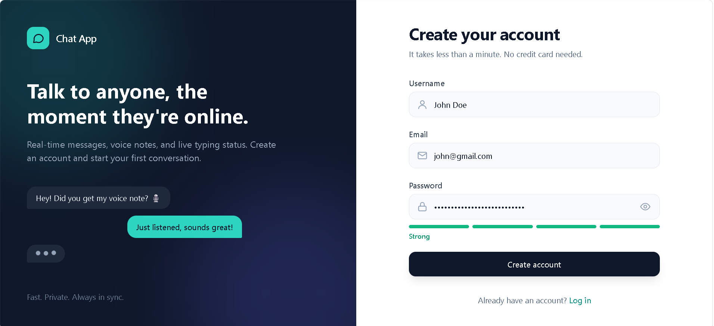
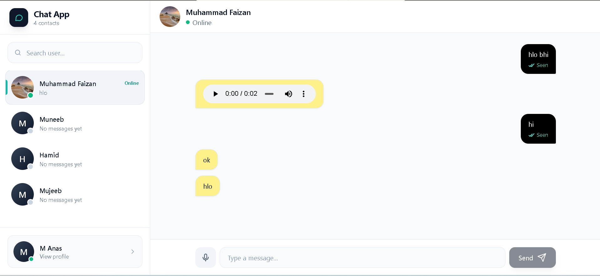
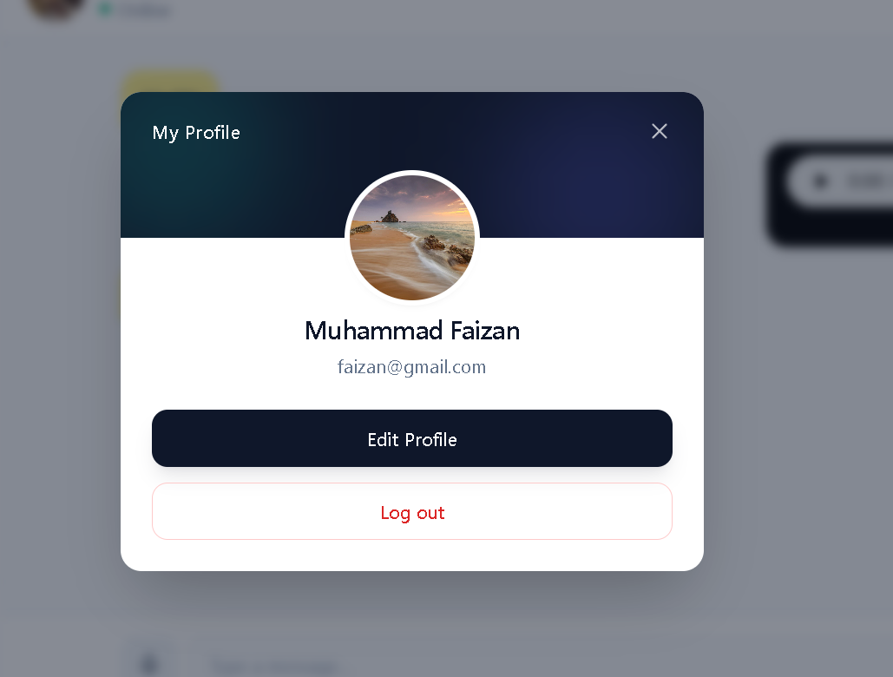

# Real-Time Chat Application 💬

A full-stack real-time chat application built using the MERN stack and Socket.IO. The application allows users to communicate in real time, manage their profiles, track online users, and exchange text and audio messages through an interactive chat interface.

## ✨ Features

### 🔐 1. User Authentication
- User registration and login.
- Secure password hashing using bcrypt.
- JWT-based authentication.
- Protected routes for authenticated users.

### 💬 2. Real-Time Messaging
- Send and receive messages instantly.
- Real-time communication using Socket.IO.
- Persistent message storage in MongoDB.
- Display conversations between users.

### 🟢 3. Online / Offline Status
- Track users' online and offline status.
- Display real-time user availability.
- Identify currently active users in the chat interface.

### ⌨️ 4. Typing Indicator
- Show when another user is typing a message.
- Provide a more interactive messaging experience.

### ✓ 5. Message Delivery and Seen Status
- Support message delivery status.
- Display seen status for messages.
- Keep users informed about their messages.

### 🎙️ 6. Audio Messages
- Record audio messages.
- Preview recorded audio before sending.
- Upload and send audio messages.
- Play received audio messages.

### 👤 7. Profile Management
- View the logged-in user's profile.
- Edit profile information.
- Upload a profile picture.
- Save profile information through the backend.

### 🔎 8. User Search
- Search for users by username.
- Find users and start conversations through the chat interface.

### 📱 9. Interactive Chat Interface
- Sidebar for browsing and selecting users.
- Dedicated conversation interface.
- Display messages and chat-related information.
- Responsive and user-friendly UI.

## 🖥️ Screenshots

### 1. Login Page



### 2. Register Page



### 3. Chat Interface



### 4. View Profile



## 🛠️ Tech Stack

**Frontend**
- React.js
- Vite
- Tailwind CSS
- Axios

**Backend**
- Node.js
- Express.js
- Socket.IO
- REST APIs

**Database**
- MongoDB
- Mongoose

**Authentication & Security**
- JSON Web Tokens (JWT)
- bcrypt

**Development Tools**
- Git and GitHub
- Postman
- Visual Studio Code

## 📂 Project Structure

```text
chat_app/
├── client/
│   ├── public/
│   ├── src/
│   ├── package.json
│   └── vite.config.js
│
├── server/
│   ├── models/
│   ├── routes/
│   ├── middleware/
│   ├── socket/
│   ├── uploads/
│   ├── server.js
│   └── package.json
│
└── README.md
```

## ⚙️ Installation and Setup

### Prerequisites

Make sure you have installed:

- Node.js
- npm
- MongoDB or a MongoDB Atlas account
- Git

### 1. Clone the Repository

```bash
git clone https://github.com/FaizanSb/chat-app.git
cd chat_app
```

### 2. Set Up the Backend

```bash
cd server
npm install
```

Create a `.env` file inside the `server` directory:

```env
PORT=5000
MONGO_URI=your_mongodb_connection_string
JWT_SECRET=your_jwt_secret
```

Start the backend:

```bash
npm run dev
```

### 3. Set Up the Frontend

Open a new terminal:

```bash
cd client
npm install
```

Create a `.env` file inside the `client` directory:

```env
VITE_API_URL=http://localhost:5000/api
```

Start the frontend:

```bash
npm run dev
```

Open the local URL provided by Vite in your browser.

## 🔑 Environment Variables

| Variable | Description |
|---|---|
| `PORT` | Backend server port |
| `MONGO_URI` | MongoDB connection string |
| `JWT_SECRET` | Secret used for JWT authentication |
| `VITE_API_URL` | Frontend API base URL |

> Never commit your `.env` file or secret credentials to GitHub.

## 🔄 Application Workflow

1. A new user registers an account.
2. The backend validates the request and securely stores the user in MongoDB.
3. The user logs in and receives an authentication token.
4. The authenticated user views and searches for other users.
5. The user selects a conversation and sends messages.
6. Socket.IO delivers real-time messaging and typing events.
7. Online status and message delivery/seen indicators update according to the application's event logic.
8. Users can record and exchange audio messages and manage their profile.

## 🔒 Security

- Password hashing with bcrypt.
- JWT-based authentication.
- Protected backend routes.
- Environment variables for sensitive configuration.
- Server-side validation and authorization applied to protected operations.

## 🚀 Future Improvements

- Video and audio calling.
- Image and file sharing.
- Group conversations.
- Push notifications.
- Message deletion and editing.
- Cloud-based audio and profile image storage.
- Production deployment and performance optimization.

## 👨‍💻 Author

**Muhammad Faizan**

- GitHub: [FaizanSb](https://github.com/FaizanSb)
- LinkedIn: [Muhammad Faizan](https://www.linkedin.com/in/muhammad-faizan-447152336/)

## 📄 License

This project is available for learning and portfolio purposes.